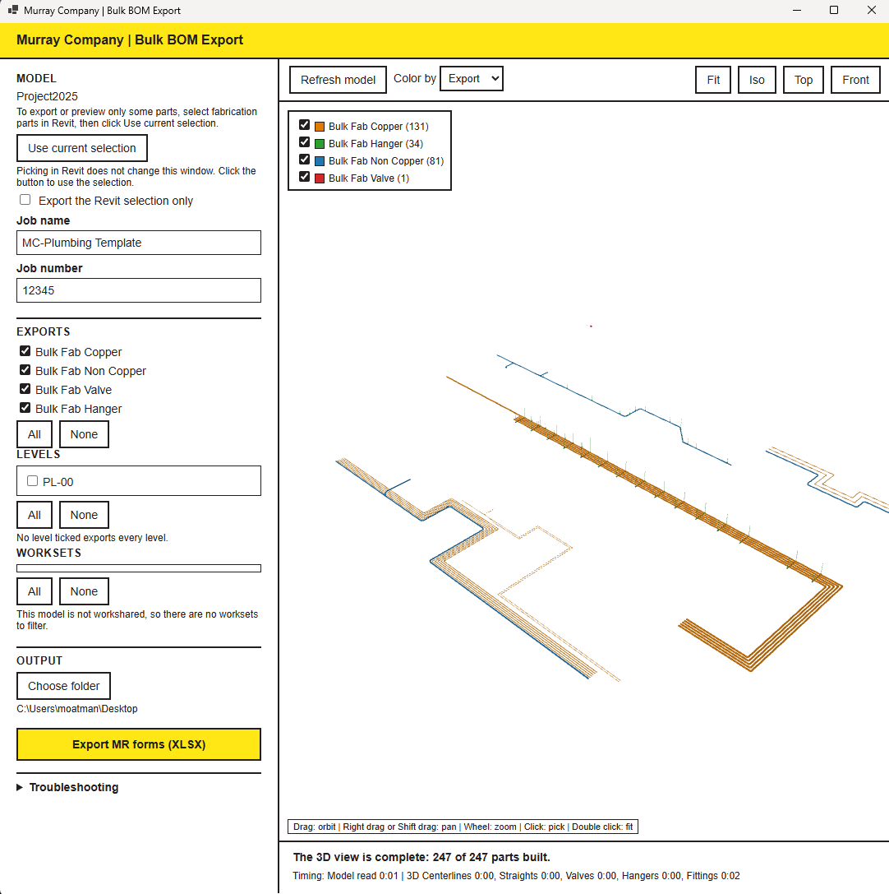

# Bulk BOM

Exports the Bulk BOM MR forms for the active Revit model as Excel (XLSX) files: **Bulk Fab Copper**, **Bulk Fab Non Copper**, **Bulk Fab Valve** and **Bulk Fab Hanger**. The window includes a 3D preview of the parts, and it stays open while you keep working in Revit.

---

## Before you start

1. Open a Revit **project**. The tool does not run in a family document.

---

## Quick start

1. Click **Bulk BOM**.
2. Wait for the status line at the bottom to say the 3D view is complete.
3. Check the Job name and Job number.
4. Tick the forms you want under **Exports**.
5. Click **Choose folder** if you do not want the Desktop.
6. Click **Export MR forms (XLSX)**. The output folder opens when the export finishes.

---

## The window

Only one Bulk BOM window can be open at a time. Clicking the button again while it is open brings the existing window to the front.

### Title bar and top toolbar

 Control | What it does 

---

 **Refresh model** | Re-reads the whole model. Use it after the model has changed so the preview and the exports match the current model. 

 **Color by** | Sets how the parts are colored in the 3D view. The default is **Export**, which colors each part by the form it belongs to (the legend in the view shows the colors). 

 **Fit** | Zooms the 3D view to show all parts. 

 **Iso** | Isometric view. 

 **Top** | Plan view from above. 

 **Front** | Elevation view from the front. 

### 3D view

The legend in the top left lists each export group with its part count, for example Bulk Fab Copper (131), Bulk Fab Hanger (34), Bulk Fab Non Copper (81) and Bulk Fab Valve (1). The checkboxes turn each group on or off in the view.

Mouse controls (also shown at the bottom of the view):

 Action | Result 
 
---

 Drag | Orbit 

 Right drag or Shift + drag | Pan 

 Wheel | Zoom 

 Click | Pick a part 

 Double click | Fit 

### Status line

The bottom of the window reports the 3D view progress, for example "The 3D view is complete: 247 of 247 parts built." The timing line below it shows how long each stage took (model read, centerlines, straights, valves, hangers, fittings).

### Left panel

### Model

Shows the name of the active Revit model.

 Control | What it does 

---

 **Use current selection** | Takes the fabrication parts currently selected in Revit. Picking parts in Revit does not change this window until you click this button.
 
 **Export the Revit selection only** | When ticked, the export and preview use only the selected parts instead of the whole model. Select the fabrication parts in Revit first, then click **Use current selection**, then tick this box.

### Job name and Job number

Filled in from the Revit project information. Edit them if the forms need different values.

### Exports

Tick the forms to write. All four are ticked by default.

 Bulk Fab Copper | Copper fabrication parts
 
 Bulk Fab Non Copper | Non copper fabrication parts
 
 Bulk Fab Valve | Valves
 
 Bulk Fab Hanger | Hangers
 

**All** ticks every form. **None** clears them all.

### Levels

Lists the levels in the model. Tick the levels to export. If no level is ticked, **every level is exported**. **All** ticks every level. **None** clears them.

### Worksets

Lists the worksets so you can limit the export to chosen worksets. **All** and **None** work the same way as for levels. If the model is not workshared, the list is empty and the message "This model is not workshared, so there are no worksets to filter" is shown.

### Output

 Control | What it does 

---

 **Choose folder** | Picks the folder the files are written to. The current folder is shown below the button. The default is your Desktop.
 
 **Export MR forms (XLSX)** | Writes the ticked forms to the output folder, then opens that folder.

### Troubleshooting

Click the arrow to expand diagnostic information in the window. Send what it shows to the admin if something is not working.

---

## How the model is read

The tool reads the parts from the model first, then builds the 3D view as a background task. While the parts are being read, Revit gives most of its time to the read, so Revit may feel slow. After the read finishes, Revit is comfortable to use again. Exports need the parts read to be complete. The 3D view is extra context only.

If the model is edited after it was read, the window shows a tag that the model has changed. Click **Refresh model** before exporting again.

---

## Notes

- Check the exported forms against the model before using them for pricing or purchasing.
