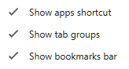

# Chrome Shortcuts

1. Ctrl + D
    1. Bookmark active tab.

2. Ctrl+Shift+D
    1. Saves all open tabs as bookmarks into a folder.
        1. User can right click on bookmark folder to open all bookmarks.
            1. In active window.
            2. In new window.
            3. In tab group
        2. User can edit bookmark names to be more meaningful

3. **Tab Groups** (Similar to Bookmark folder above, new chrome feature)
    1. Hold CTRL and select open tabs, right click,Add tab to group.
    2. Make sure you have the following features enabled
        
    3. Right clicking on the new group will allow user to open up single pages.
    4. User cannot rename bookmarks in tab groups

4. Hold CTRL when clicking on links and those links will open in a separate tab.
    1. Almost everything in ACC is a clickable link
