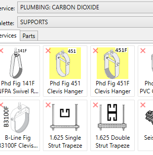
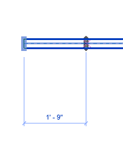
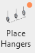
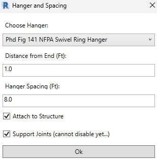
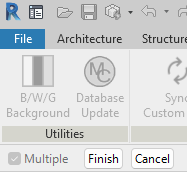
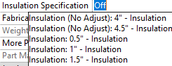
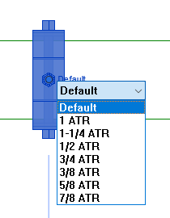
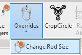
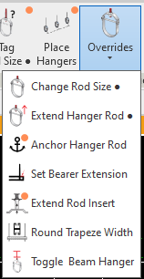

# Fabrication Hangers in Revit

**Populating Hangers**

- **Manually** (Should not be used for bulk populating)
    - Hangers can always be placed one at a time by clicking on a hanger button in service pallet and then selecting pipe or duct and the location where you would like the hanger to be placed.
    

- To add multiple hangers in a run **DO NOT** use the copy command.
    - Use **CS** / Create Similar command instead

- **Murray tools** (Better at bulk population)
    - Click on Button
    

- Select a pipe or duct.

- Set hanger type and desired spacing, click OK

- Select (window) which pipes or ducts you wish to place hangers on. Look for Finish button on top left corner of Revit to complete selection.

- Command will stop and start at joints and fittings (for now). Hanger spacing does not wrap around changes of direction.

- **Hanger population will be restricted to the service of the part chosen at the start of the command.**

**Managing Hangers**

- **What just happened?**
    - Now that we have some hangers in the model what do we do with them and what data should you be looking for to ensure fabrication goes well.
        - **Hanger Model**
            - Did you draw the right hanger make and model?
        - **Trapeze hangers**
            - **Must be modeled in 2" increment widths.**
                - Example: 7", 9", 11", 13" etc width from rod to rod = BAD
                - Example: 8", 10", 12", 14" etc from rod to rod = GOOD
                - One last attempt to explain, ANY rod to rod dimension that is not an EVEN 2" increment is **wrong**.
        - **Hanger Spacing**
            - Did the robot or you put hangers on the element in a way they can be installed and per code or project specifications?
        - **Hanger Size**
            - Sometimes Revit will allow 1-1/4” hangers on 1-1/2” pipe and vice versa. Be aware of the possibility and look occasionally.
        - **Encapsulated verses Shields**.
            - This is controlled by the type of Insulation added to the pipe.
            - Users must make the right choice to have the hangers draw oversized or pipe size.
                - Insulation (No Adjust): = Encapsulate
                - Insulation: = Oversize the hanger to accommodate insulation thickness.
                    
        - **Rod Size**
            - All default rod sizes are derived from the database.
            - They are sized per CPC / CMC by default.
                - Detailers must request rod sizes be updated in database to match their project requirements.
            - Users can manually change “one-off” rod sizes via selecting any hanger and clicking on the “Default” word to show a list of available rod sizes.
                
            - Alternatively, there is a button on the Murray ribbon that can modify rod sizes in masse.
                
                - This button has (2) modes.
                    - **Mode 1** (simply left click on button) and the user can window some hangers and change override the selected hanger rods to a specific size.
                    - **Mode 2** (Hold SHIFT while left clicking button) the user can specify rod sizes for size ranges of pipe. This mode can apply different rod sizes based on pipe size supported across an entire floor.
        - **Rod Length**
            - **Fabrication hanger rods will extend up to the first structural element they encounter by default when being modeled.**
                - Rods will extend to bottom of concrete above.
                - Bottom of Steel Beams (if hanger is placed under beam)
                - Bottom of incorrectly modeled concrete or steel.
                - It is possible during coordination or model revisions that a hanger can become disconnected from structure. Using move, selecting a hanger and moving in the Z is an example of that. Reloading database with Arch or Struct models unloaded is another.
            - To have the rods re-extend back to the deck use the Attach to Structure button.
                
            - To make this button present itself you must **only have fabrication hangers selected**.
            - There are also tools in the Murray ribbon to aide in extending rod to a user location rather than using elements found in Arch or Struct links. The rod extension tools can be somewhat redundant to each other so you only need to use the tools necessary to achieve the desired results. Not all tools need to be used. **If you are fortunate and everyone uses Revit correctly, it is possible to complete a project without requiring any rod stretching tools.**
            - **Extend Hanger Rod** (has 2 modes) Users can extend hanger rods to a reference plane or using an elevation entered into a dialog.
                
            - **Anchor Hanger Rod** can be used to set an attachment point / location for rod to stop.
                - Populate anchors
                - Run Attach to Structure function to attach hanger rods to the anchors.
                - Select all anchors and change their elevation in properties or use move command.
            - ~~**Extend Rod Insert**~~ ~~can increase rod length from the "Attached to Structure" elevation.~~
                - ~~Requires hangers be attached to structure to work.~~
        - **Hanger rods and point layout**.
            - If you have hanger locations in your model that need to be filtered out for point layout, you can use the **Toggle Beam Hanger** button.
            - This will allow us to exclude those hangers when exporting for deck layout vs exporting to locate beam clamp location.
            - This also helps avoid adding insert depth calculations to rod length on hangers attached to beams
        - **Hanger Location**
            - **Lastly, if you modeled your hanger in a location where it cannot be installed, you have failed the mission.**

Training Videos:

https://murraycompany.egnyte.com/dl/PrYCyVKDjrhw

https://murraycompany.egnyte.com/dl/CKdwPKGjwBRF

https://murraycompany.egnyte.com/dl/Dh3RXjPtj6BY
