# Fabrication Part BOM (Excel)

**Why and when do we BOM?**

**Bulk Buyout BOM**

**Why** - Typically used to procure large amounts of material and lock in pricing.

**When** - As requested. Can happen at any time (usually before spooling).

**Man loading BOM**

**Why** - Used to set up the man load tracker in order for the field to track productivity.

**When** - As requested (Before spooling)

**Preliminary BOM**

**Why** - Produced so that material for spool package can be **ordered**, **delivered**, and **ready** when spool package is sent to shop.

**When** - Run on scope of work being requested to fabricate. (When spool request is made)

**Final BOM**

**Why** - Produced and is 100% reflective of all material inclusive of the specific spool package. It is used to reconcile any differences, if any, that occurred from when the preliminary BOM was generated to when the final BOM was generated.

**When** - Ran by cad support, not a detailing dept BOM. (After spooling)

There are 2 ways we can get an Excel version of the Fabrication BOMS exported from Revit.

## **1. The Fabrication CSV export option (Same as AutoCAD):**

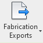

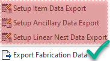

This method requires the least amount of skills and can be replicated in the AutoCAD environment. The major drawback with this method is that you must select the elements you wish to run the export / BOM on.

Select some Fabrication parts in Revit.

* The key here is to **ONLY** have Fabrication parts selected.

  * Use the Filter button to ensure you have only selected Fabrication parts.
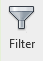
* Once parts are selected, locate the Fabrication Exports button. It will appear as a contextual option once parts are selected.
* Choose the export option.
* Check the exports you want.

  * Check the one you want or check them all, either way. (see image for standard exports)
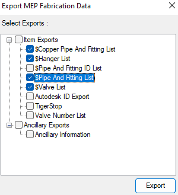
* The exports will automatically be saved to the root of the C: drive in a dated folder.
* **Converting CSV to XLS will be covered below**

\---

\---

## **2. Revit Schedule, export to CSV:**

* **Revit Schedule, export to CSV:**

This method requires you make or have a schedule that collects the necessary information.

There is some data on the Fabrication parts that is not accessible natively so a button was created that will make that data visible.

The Sync Fabrication Part Parameters button is the data pusher.

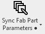

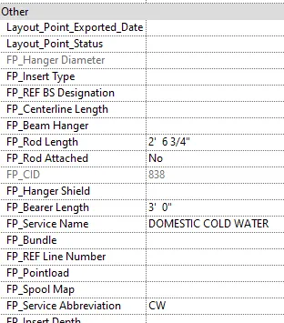

* Simply clicking on button pushes data into Fabrication parts in active view.
* Shift+Click on the button to push data into Fabrication parts in entire model.
* Select elements and then pushing the button on updates the selected parts.
* You are limited in a worksharing environment as to how much content you can touch while others are in the same model.

**ONE THING TO NOTE: THE DATA IS STATIC, IT IS ONLY UP TO DATE WHEN THE SYNC BUTTON IS PUSHED.**

**NEVER TAKE IT FOR GRANTED, ALWAYS PUSH THE BUTTON AGAIN IF EXPORT A SCHEDULE USING THAT DATA.**

If you didn't know all the FP, TS, STRATUS parameters in the Other section of properties are ours and you can push useful data into those parameters enabling creative schedules and filtering Revit content.

The Schedule must be formatted to match the Excel template we have created.

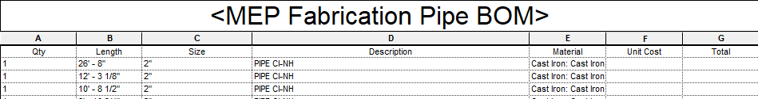

Once you have a functioning schedule, simply export that to CSV.

* Use the Revit out of the box method (see image below)

  * Take note of the options
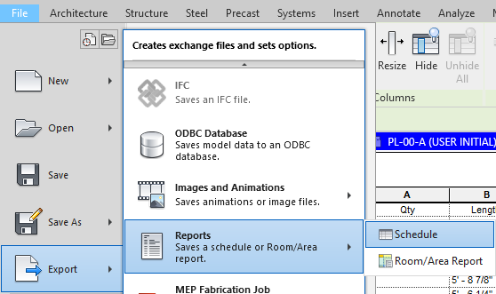
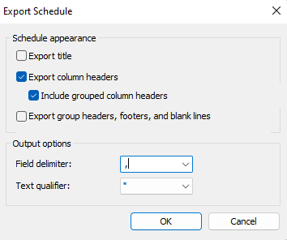
* Use Murray Tools option (Schedules To CSV)
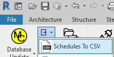
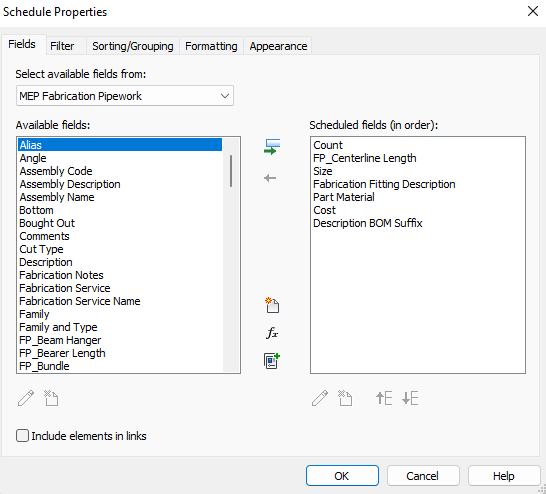

\---

\---

**1. Converting CSV to Excel:**

* **Converting CSV to Excel:**

Converting the exported CSV is relatively easy.

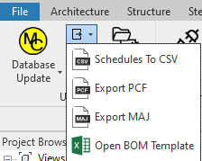

* Click the Open BOM Template using the button on Murray Ribbon. (Next to Export)
* When the template opens you will be prompted to locate in import file.
* Browse to the CSV file location.
* Once the data imports, Click on the Murray logo to sort.
* Saveas the Excel file as an XLSX file and send it out.

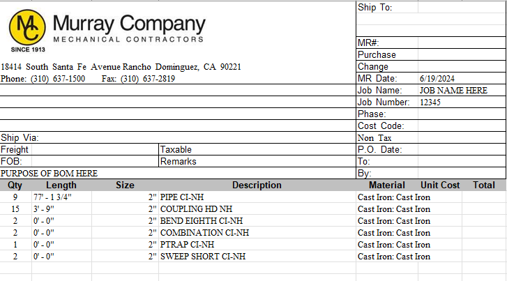

https://murraycompany.egnyte.com/dl/fJppBYypMYPt
