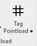

# MC Pointload (Duct)

1. “The first rule about Pointloading is… You don't talk about Pointloading.” **We (Murray) don't offer or suggest it should be done, we simply provide the service if requested. Even if requested, it should still be mentioned to project management that you are being asked to provide them.**

2. If you have completed step 1 you should know your process and required deliverables. That information will come from the GC. If they do not provide those details**. ASK**
    1. What shape are your loads going to be in?
    2. What color are your loads?
    3. Is your load unit actual weight or / 10x?
    4. Is the deliverable a PDF or a DWG export?

3. Remember, Pointloading does not happen in a vacuum. The task of Pointloading is to learn where and how much weight **ALL MEP** trades are adding to the concrete deck. This task is not effective without everyone's input. **In short… The entire MEP team must be involved and provide the same deliverable in the same format. Typically some kind of composite will be generated.**

4. Now that the formalities are out of the way. Lets get down to business. There are some buttons in the Murray Ribbon to help with this process.
    

5. The Duct Pointload button will help with Pointload process.

6. This button works in (2) steps.
    1. First, select a run of duct(s).
        1. Click finish button in the top left corner.
    2. Second, select the hangers supporting the selected duct(s).
        1. Click finish button in the top left corner.
    3. The program simply collects the total weight of selected duct(s) and then divides that weight amongst the selected hangers.
    4. All Pointload options favor the 10x method.
    5. Lastly the loads on selected hangers with 2 rods or straps will be divided in half so 50% of the load can be tagged on each point of the support.

7. Tagging the Pointload for deliverable.
    1. Simply click on the Tag Pointload button. It will tag every fabrication hanger in the view.

