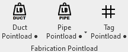
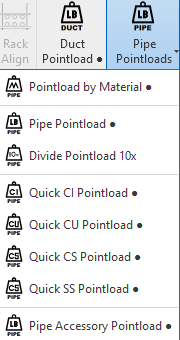
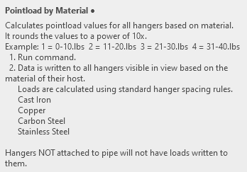
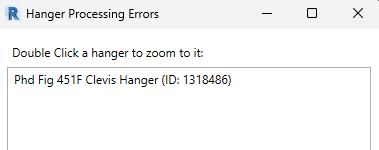
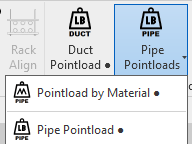
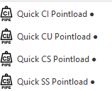
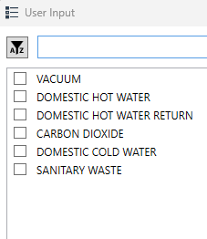

# MC Pointload (Pipe)

1. “The first rule about Pointloading is… You don't talk about Pointloading.” **We (Murray) don't offer or suggest it should be done, we simply provide the service if requested. Even if requested, it should still be mentioned to project management that you are being asked to provide them.**

2. If you have completed step 1 you should know your process and required deliverables. That information will come from the GC. If they do not provide those details**. ASK**
    1. **I change my mind, don't simply ask for this. Suggest what you will provide.**
    2. Your desired shape is a circle.
    3. Your desired color is **RED**.
    4. Your desired load unit is actual weight / 10x.
    5. Your desired output is a dwg extraction of an entire floor.
    6. **Controlling those 4 factors will streamline your Pointloading journey.**

3. Remember, Pointloading does not happen in a vacuum. The task of Pointloading is to learn where and how much weight **ALL MEP** trades are adding to the concrete deck. This task is not effective without everyone's input. **In short… The entire MEP team must be involved and provide the same deliverable in the same format. Typically some kind of composite will be generated.**

4. Now that the formalities are out of the way. Lets get down to business. There are some buttons in the Murray Ribbon to help with this process. **
    **
    

5. There are many options when it comes to Pipe. The fastest (**by far…**) is to use "**Pointload by Material**".

6. This option will automatically Pointload an entire floor by adding loads to the hangers based on max hanger spacing by material and pipe size.
    1. What does that mean? Deep breath…
        1. Ex: 2" No-Hub Cast Iron Pipe is **maximum 10ft long**. Each pipe will have **2 hangers** on it. Each hanger will support a **maximum of 5ft of pipe.** Weight of 1ft of 2" pipe (water filled) is 4.95lbs.
        2. 4.95lbs * 5 = 24.75lbs which would get a "3" in thePointload parameter.
            1. 24.75 rounded up to nearest 10 lbs and then divided by 10. Exhale…
        3. To be clear all 2” hangers on No-Hub Cast Iron will get 3’s regardless of pipe length because we are calculating **MAX** loads.

7. Push the "Pointload by Material" button.
    1. The program needs to determine the size of pipe that hangers are attached to or hosted on in order to calculate weight being supported.
    2. The warning below will most likely pop up. It means either you modeled your single hangers incorrectly by using the copy command or its a trapeze. The trapeze hangers can be ignored as they aren’t normally hosted to a single pipe (they usually carry multiple pipes).
        1. Click on the ID number to select the hanger
        2. Click on the magnifying glass to select and zoom to hanger.
        3. Any single hanger that is not connected to pipe (without good reason) should be corrected. (Replace hanger…)
        

8. Trapeze racks need to be processed a bit more manually. This manual process can also be used on single hangers if necessary. (I strongly recommend the method above for single hangers…) Lets proceed.

9. The Pipe Pointload button is the hand crafted way to Pointload.

10. This one works in (2) steps.
    1. First, select a run of pipe(s).
        1. Click finish button in the top left corner.
    2. Second, select the hangers supporting the selected pipe(s).
        1. Click finish button in the top left corner.
    3. The program simply collects the total weight of selected pipe(s) and then divides that weight amongst the selected hangers.
    4. All Pointload options favor the 10x method.
        1. Notice there is an actual weight option for this button when executed with [SHIFT]+click.
    5. Lastly the loads on selected trapeze hangers will be divided in half so 50% of the load can be tagged on each rod of the trapeze.

11. Let’s touch on the last option for pointloading. The Quick commands.

12. These commands will perform the same as “By Material” calculation but will prompt user to pick a service to calculate rather than reading the pipe material directly. Provides a little more flexibility or a way for the user to force a certain calculation by material on a service (even if material in pipe is not correct).
    1. Click on Quick button with the material abbreviation you want calculations based on.
        1. CI = Cast Iron
        2. CU = Copper
        3. CS = Carbon Steel
        4. SS = Stainless Steel
    2. Choose the service you want to run the calculations on.
    3. Click Select at the bottom of dialog and calculatio will run.
    
    13. Tagging the Pointload for deliverable.
        1. Simply click on the Tag Pointload button. It will tag every fabrication hanger in the view.
        

Training Video:

https://murraycompany.egnyte.com/dl/m6KPQTyB8jr3