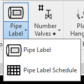
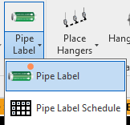
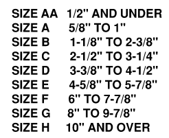

buttons: Pipe_Label, Pipe_Label_Schedule
# Pipe Labels

- Click on the Pipe Label button.

- Select a pipe in the model.

- The button will place a label on the selected element and (kind of lock) you into the Z elevation of part.

- Pick the XY location of the desired label location

- The arrow will always point AWAY from the nearest pipe end of the XY location specified.

- Label spacing is appox every 20ft. (Just rumors at the moment)

- Make a schedule of the labels (An easy button exists in the Ribbon)
    - No output to field or fab shop is technically required
    - The labels will show up on spools.
    - User can create a BOM of the labels required from the schedule generated.
        - Label sizes will show actual diameter and the order letter (from R&R Labels) / See catalog below
        > **Order letters are strictly for ordering from R&R labels. See catalog below.**

> [R&R Snap-On-Strap-On-Pipe-Markers.pdf](files/RR_Snap-On-Strap-On-Pipe-Markers_-3-.pdf)
