# Point Layout (MC)

1. Locate the Ribbon Tab called MC Point Layout.

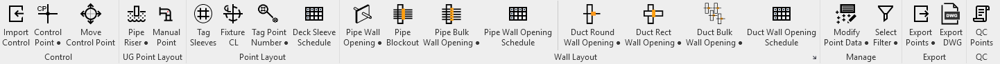

- **Make a View to be Used for Point Population**

- **Views will be created by level**

- **In Revit, duplicate an existing sheet view**
    - I prefer to copy the floor plan view of the deck I’m going to layout (working down…). It is not the ONLY way to do it.
        > The strategy is (YOU MUST SEE THE ELEMENTS YOU ARE TRYING TO LAYOUT AND ONLY THOSE ELEMENTS!).
    - **In the 'Project Browser', go to 'Sheet Views', choose the sheet view of the deck level you’re inserting on, Right mouse click, select Duplicate View, and select 'Duplicate'**
    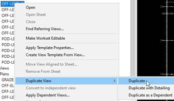
    - **Re-name the duplicated view based on the overhead (OH) utilities you are inserting for and the deck level you are inserting on - L# OH - L# DECK**
        - **If there are sperate buildings, indicate the building name as a prefix - BLDG L# OH - L# DECK**
    - **In 'Properties', under 'Identity Data', change review the view template.**
        - You may need to change it or remove it, depending on your needs.

- **In 'Properties', under 'Extents', pick the 'Edit…' button at 'View Range' and adjust the view range in the view like below:**
    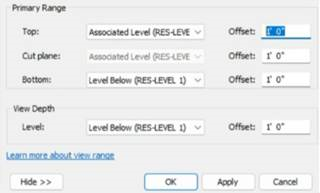

- You are carving out a specific window of space that will capture the deck for layout and the services immediately below.

- **In 'Properties', under 'Underlay', change 'Range: Base Level' to 'None'**
    > watch for this setting as it overrides the view range settings.

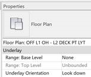

- **Adjust the view for best optimal viewing. This will be used for your Trimble shop drawings so it's best to try to make it look as good as you can.**
    - **Open 'Visibilty/Graphic Overrides' (VV or VG), select the 'Revit Links' tab, and uncheck any link that does not need to be displayed in the view.**
        - **Only the Architectural background should be visible in final output.**
        - Consider making MEP Fabrication Pipework / Ductwork halftone.
        - make it… B U T FUL
    - **You may want to adjust the view range so that the offset for the 'Top' and 'Cut plane' is at (-1") so as to not capture the Arch background above.**

- **In the 'Properties', under 'Graphics', change the 'Sub-Discipline' to 'Point Layout', which will locate your view under 'Point Layout' in the 'Project Browser'.**

- **Note that in 'Properties', under 'Identity Data', there is an '!MC_Point Layout' template that can be assigned and altered to automatically take care of some of the steps indicated above.**
    - **You can also alter other features like turning off components in external links so that they won't show in the view so that assigning the template will help in your future view creations for your project.**

1. **Place Control Points Using the 'Control Pts' Function**
    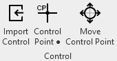
    - The Ribbon panels are in order based on workflow. Control point tools being the first panel.
    - Import Control is to import a csv file of control point locations (provided by GC)
    - Control Point button (Has 2 modes)
        - Simply click on it to place a point at picked location
        - SHIFT+Click to place a point at the intersection of selected grid lines
    - Move Control Point just helps you grab a control point easier and move it a specified X, Y offset.
    - Below is the SHIFT+Click workflow as it provides the best output with minimal effort.
        - Pick (2) grids that intersect. Click Finish.
    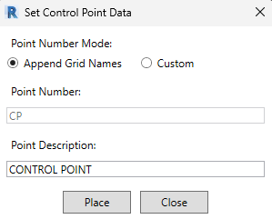
    - **You can pick multiple grids with multiple intersections during this process.**
    - It is standard practice to append grid line names to control points.
    - Click Place button to insert Control Point elements at all intersections discovered.
        - Control Point will most likely need to be moved or ‘Offset’ from grid line intersections.
    - You should dimension and tag each Control Point from adjacent grid lines.
    - **Control points can be copied to levels above or below to layout other decks.**

- Know your content. Review elements to learn if elements like DRAINS, SLEEVES, SEISMIC have layout points embedded in them.
    - If families are missing the layout points you must edit them and add the layout points.

- Families that have the layout point, you may want to add or modify data associated with that point.
    - **Hover on 'Select All Instances' and either pick 'Visible in View' or 'In Entire Project' depending on the type of family it is**
        - **Pick 'In Entire Project' when 'Visible in View' is not an option**
        - **Type 'HI' to isolate the items**
        - **Select all the items and select 'Finish' at the top left of the screen**
        - **Note that you can select individual items one at a time and don’t have to isolate if there aren’t many to modify.**
        - **Go to 'Murray Point Layout' and select 'Modify Point Data'**
        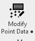
        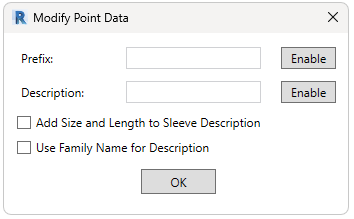
        - **This can add the point numbering prefix and a point description to the exported data of points.**
            > **Note that if you have specific seismic locations with upsized inserts, it would be best that information be included in point description.**
        - **Type 'HR' to restore the view**
    - **It is always best to have points embedded inside the family, it is possible to manually place a point at any location the user wishes to layout.**
        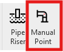
        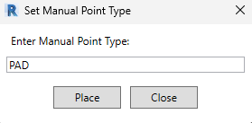

- You can control point data with the Modify Point Data button
    - Add or modify a point prefix
    - Add or modify a point description
    > Re-format insert description - not required using MC methods
    - Add Size and Length to Sleeve Descriptions
    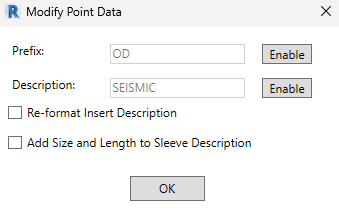

- **Sleeve descriptions are handled automatically during export now.**
    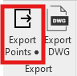
    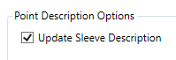

- The point numbers and descriptions are handled with the following parameters.
    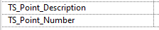
    - You are free to type data into these parameters without any tools if desired.

- Fabrication hanger locations will be exported without the need to populate layout points on the rod.
    - The point description of the hangers can be set to show the INSERT size automatically. No extra steps required.
        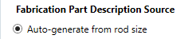
    - **Under the 'Export' section in the 'MC Point Layout' tab, select 'Export Points'**
    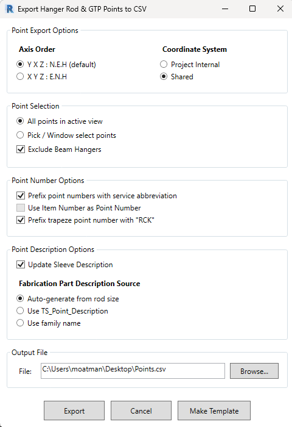
    > The settings shown in image are the default settings for Mech Pipe and Plumbing. Change them to fit your needs based on option descriptions below.
    - The dialog will default with YXZ option and shared coordinates as they are standard.
    - Point Selection can be entire view or window selection
    - Point Number Options
        - Prefix point numbers with add the service abbreviation to the point number automatically. Does exactly what it says.
        - Use Item Number as Point Number will use a pre-defined number as the point number rather than assigning a random number on export.
            - This is used if the user wishes to have the layout points match the hanger spool numbers.
        - Prefix Trapeze Point Number with “RCK”. Does exactly what it says.
    - Point Description Options
        - you can have the sleeve point descriptions automatically update to show diameter x length.
        - Fabrication Part options (It’s really just Fabrication Hangers)
            - Auto-generate from rod size
                - Creates a point description indicating insert size read directly from hanger. eg: ‘INSERT 3/8’
            - Use TS_Point_Description
                - Uses (existing) TS_Point_Description parameter data without any modifications.
            - Use family name
                - The Family Name will be the description
    - Output File
        - Specify path and filename of export.

- **REVIEW** your export file!
    - Check point number prefixes.
        - Do you want them?
        - Are they correct?
    - Check point descriptions.
        - Is there a description / does it need one?
        - Is the data in description helpful?
        - Is the description correct.

- Repeat export as many times as it takes to get all the data complete and acurate.

- Locating elements to correct data.

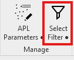

- The Select Filter button has (2) modes.
    - If user just clicks on button there is a simple dialog that just finds point numbers.
        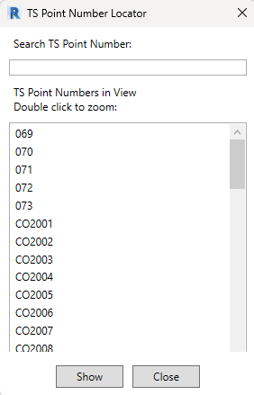

- SHIFT+Click will give user a more advanced search dialog.
    - It has the same TS parameter data to search thru but also can search more data.
    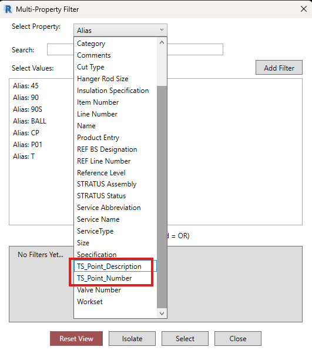
    - Choose the property to look for data in.
        - TS_Point_Number (point number in CSV)
        - TS_Point_Description (point description in CSV)
    - Double click on any data presented you want to see.
    - Click Isolate or select to locate the element(s)

- Once you have cleaned up all the data. Export a final time to get the complete CSV file

- Export a DWG background of the points.
    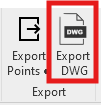
    - Simply specify location and file name of the exported DWG.

- **Finalize CAD Background**
    - **Launch AutoCAD and open the exported DWG file**
    - **Once opened:**
        - Burst or explode backgrounds (if needed)
        - **Do OVERKILL command until there are zero overlapping objects or segments**
        - **C8ALL command**
            - **This changes all layers to color 8**
        - **CLEAN command**
        - **AC command, pick (7) White, and then select a dimension to the sleeves and CPs and select a CAN or CP callout, along with their leaders**
            - **This changes the layer color to these items to White**
        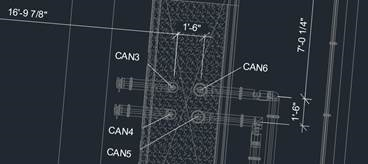
        > **Save the DWG**

- **Check Point Alignment Between CSV and Background**
    - Back in Revit, click the QC Points button.
    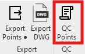
    - This button has (2) modes.
        - Just click - copied point data to clipboard without dialog.
        - SHIFT+Click shows point data in a dialog (nothing user can do here, just visual)
    - Click the copy button in the QC dialog
        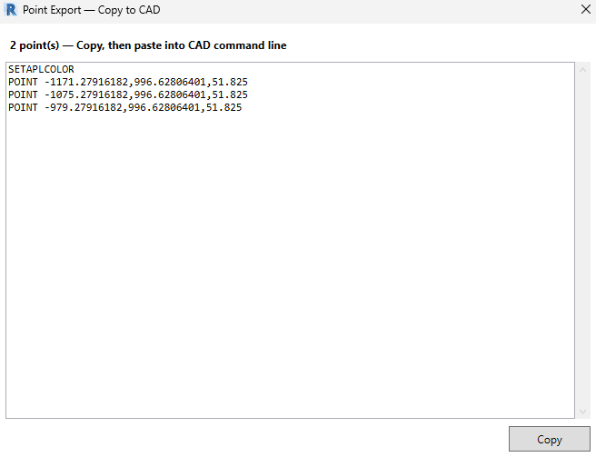
    - Back in AutoCAD Left click with your mouse in the command line and hit Ctrl+V to paste the point locations from the CSV file
    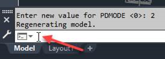
    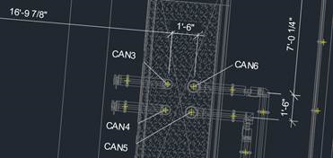

- Notice the yellow cross hairs that are now indicated on, hopefully, ALL the components that require inserts.

- Carefully, pan through the drawing to verify that all points have been captured and that there are NO points that should not be captured.

- **Creating Final .DWG and Final .CSV**
    > **If everything checks out and it is determined that everything is 100%, close the DWG and DO NOT SAVE.**
    > You can RENAME the CSV export performed earlier to match exported DWG or go back to Revit and export again.
    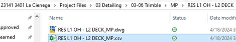

- **Create the Trimble Shop Drawings (Forthcoming)**

Training Video:

[Point Layout training video (Egnyte)](https://murraycompany.egnyte.com/navigate/file/1a01c2dd-9164-4671-9bad-bdc01ef42fde)
