# Point Layout (UG)

**View and View Range Creation:**

Create View in Revit from Upper Level. (Ex. L1 would be copied and renamed to UG Overhead L1 Deck - UG OH_L1 DECK TRMBL)

The associated level should refer the floor above that you are working on.

You want to set the Top as the level above Underground and select the bottom to be unlimited to show all the underground piping.

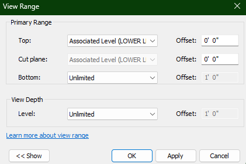

**Trimble Point Pipe Route Callouts:**

One of the main goals to remember for UG Trimble is to capture all pipe routing changes and to place a point to call out that direction.

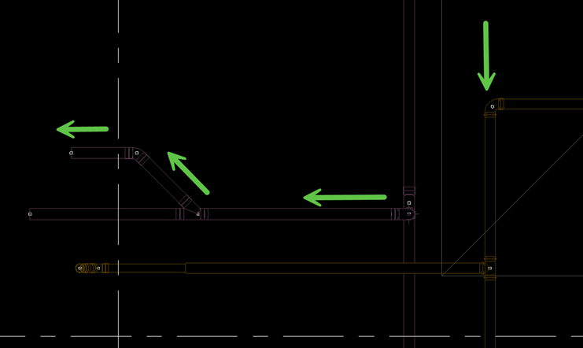

There are a few rules that apply to Tee's, Combi's, and Wye fittings. When dealing with a Tee, the Trimble point goes based off the direction of pipe branch at the 90°. Similar to the Tee, the Combination Trimble point is also placed where the location of the branch. Wye Trimble points are placed on the branch of the wye itself even if the

Tee:

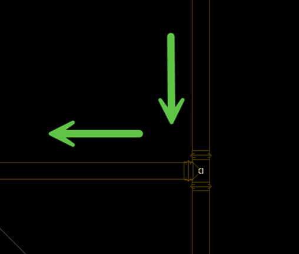

Combination:

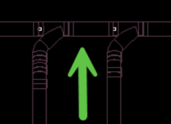

Wye:

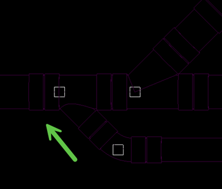

**Adding Manual Points:**

Only way to add points the floor plan is to manually insert each with the Autodesk Point Layout Tab in the Revit Ribbon.

To add points manually. You will need to navigate to the Manual button within Autodesk Point Layout Tab

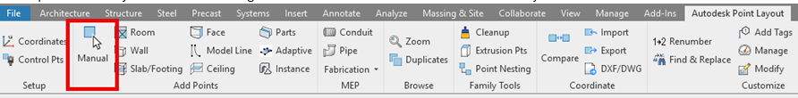

You will need to change the Point Type to Pipe Pt, add the Point Prefix of the service being called out, and then change the number to begin at 1. There are point numbers that each category defaults to so don’t forget to change it.

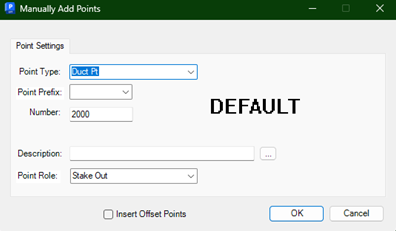

You are going to want to select Workplane because its easier to have the point Snap into place.

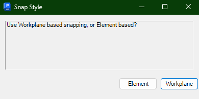

Make sure the point placement is done on the snap point circle. This way to ensure you are selecting the correct location on the pipe.

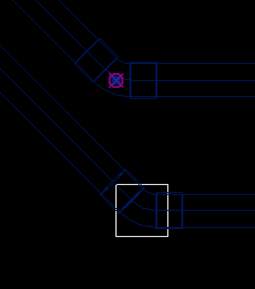

Each point will be based off the Fabrication Service they will be placed on. (Depending on the service, you may need to get fancy and create one. Make sure it's not long as these are supposed to be an abbreviation.)

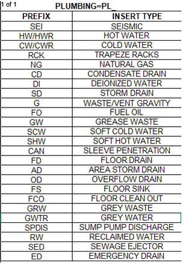

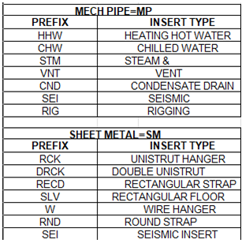

After the pipe routing has been called out you can start on your fixtures. You will possibly have Floor Drains, Floor Sinks, and Floor Sleeves around the model that will need to tagged. (If any drain does not have a Trimble point, contact Mitchell Oatman or Francisco Cruz to ensure the point is added to the family. )

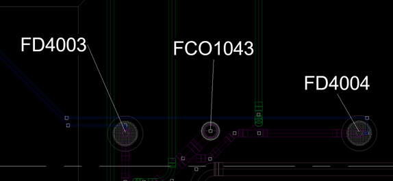

APL Parameters can be used to renumber the points and add custom descriptions. Best practice would be to isolate the part itself and use the APL Parameters button.

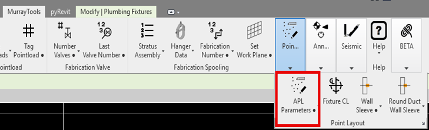

Enabling the prefix gives you access to override the previous information for that point and the same process goes for the Description. Reformatting and Adding size can be ignored as those are for Wall Sleeves

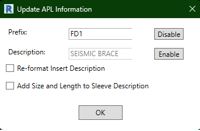

**APL Manage:**

This is where the hub where all the point information is located. This will give you the prefix, coordinates, and description that will you will export to a CSV.

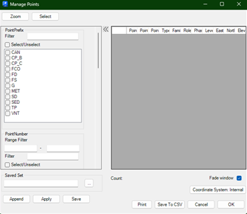
