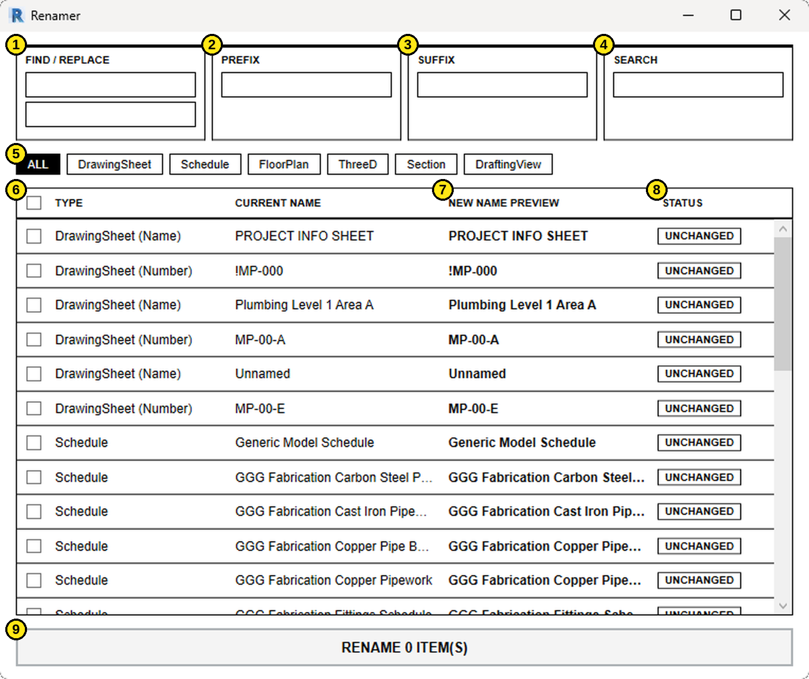

# Rename Sheets and Views

Renames many sheets and views in the open Revit project at once. You pick the items, type your changes, check the live preview, then apply everything in one step.

Nothing in the model changes until you click the **RENAME** button at the bottom.

## What it renames

| Item | What changes |
|---|---|
| Sheet name | Each sheet has its own row, labeled `DrawingSheet (Name)` |
| Sheet number | Each sheet has a second row, labeled `DrawingSheet (Number)` |
| Views | Floor plans, ceiling plans, elevations, sections, 3D views, drafting views and schedules |

Not listed: view templates, and the system schedules Revit does not allow you to rename (title block revision schedules and internal keynote schedules).

## The dialog

*The dialog as it opens. Nothing is selected, so every row shows UNCHANGED and the button reads RENAME 0 ITEM(S). Your item names will differ.*

## How each feature works

### 1. Find / Replace
Type the text to find in the top box and its replacement in the bottom box.

- Matching is **case sensitive**. `Level` will not match `LEVEL`.
- Every occurrence in a name is replaced, not just the first.
- Leave **Replace** empty to delete the found text.
- Leave **Find** empty to skip this step.

### 2. Prefix
Text added to the start of every name. Example: `L1-` turns `Plumbing Plan` into `L1-Plumbing Plan`.

### 3. Suffix
Text added to the end of every name. Example: `-DRAFT` turns `Plumbing Plan` into `Plumbing Plan-DRAFT`.

**Order of operations:** Find/Replace runs first, then the prefix and suffix are added around the result. All three can be used together.

### 4. Search
Filters the list to rows whose **current name** contains your text. Not case sensitive. It only changes what you see. It does not change what is selected.

### 5. Type chips
The buttons under the input boxes filter the list by type. **ALL** shows everything. The black chip is the one currently active. Chips only appear for types that exist in your project.

Order: DrawingSheet, Schedule, FloorPlan, CeilingPlan, ThreeD, Section, Elevation, DraftingView.

### 6. Selecting rows
Only checked rows are renamed.

- Click a checkbox to select a single row.
- **Shift+click** a second checkbox to select or clear the whole range between the two clicks.
- The checkbox in the header selects or clears every row **currently shown**, so it respects the active chip and Search filter.

Selections are kept when you change chips or Search, so you can build up a selection across several types.

### 7. New Name Preview
Shows the result of your Find/Replace, Prefix and Suffix for every row, updating as you type. Check this column before renaming. Hover over a truncated name to see the full text.

### 8. Status
Each row shows one status.

| Status | Meaning |
|---|---|
| **WILL RENAME** (black) | Checked, the name changes, and no problem was found. This row will be renamed. |
| **NOT SELECTED** | The name would change, but the row is not checked. |
| **UNCHANGED** | The new name matches the current name. Nothing to do. |
| **CONFLICT** (heavy border) | Checked, but the new name cannot be used. This row is skipped. |

A row is flagged as a **CONFLICT** when:

- the new name is blank,
- the new name matches a name that is staying as it is, within the same type, or
- two selected rows would end up with the same new name.

Sheet names are the exception. Revit allows repeated sheet names, so only a blank sheet name is flagged. Sheet numbers and view names must be unique.

### 9. RENAME button
The button shows how many rows will be renamed, for example `RENAME 3 ITEM(S)`. It is disabled when that count is zero.

The count includes every **WILL RENAME** row, **even rows hidden by the current chip or Search filter**. Clear the filters and scan the full list if you are unsure what is selected.

## What happens when you click RENAME

1. All renames are applied in a single Revit transaction named **Rename Sheets and Views**.
2. If every item succeeds, a short Windows notification shows the number renamed and the dialog closes.
3. If some items fail (for example, Revit rejects a name), the rest are still renamed. A message lists the failures, up to 15, and the dialog closes.
4. If the whole operation errors, it is rolled back and nothing is changed.

## Example: change "Level" to "LVL" on selected plans

1. Click the **FloorPlan** chip.
2. Type `Level` in Find and `LVL` in Replace.
3. Check the plans you want, or use the header checkbox to select them all.
4. Review **New Name Preview** and fix any **CONFLICT** rows.
5. Click **RENAME**.

## Tips

- Use Search to find a group of similar names, then the header checkbox to select just those.
- Sheet numbers are separate rows. If you only want to rename sheet names, leave the `DrawingSheet (Number)` rows unchecked.
- To renumber sheets with a prefix, select only the `DrawingSheet (Number)` rows before entering the prefix.
- The dialog can be resized if names are cut off.

## Open items

- [CONFIRM: ribbon tab, panel and button name used to launch the tool]
- [CONFIRM: behavior on workshared models when an element is owned by another user]
