# Revit Family Library and Creating Families (From Imports)

**We have a family library where we are collecting and maintaining families.**

- C:\Egnyte\Shared\BIM\Murray CADetailing Dept\REVIT\FAMILIES

- You can set a shortcut or quick link to the location above in your load family dialog.
    - Version Specific, will have to add shortcut in ALL versions of Revit Installed

- There is a button on Murray Ribbon that will load directly from the path above.

**Disclaimer: This is NOT NOT the cleanest most bestest way to make a family for Revit.**

- This method of family making is best suited for one-off instances of equipment or elements that do not occur 100's / 1000's of times in the model.

- The intent of this training is not to encourage all of you to start making your own families and scabbing your way thru Revit without any guidance.

- The intent is to show you some simple steps on how to get started creating Revit families.
    - Creating one-off Equipment families to save space.

**The general workflow of acquiring a family is as follows:**

1. Look in Murray Library for the family that is needed.

2. If family does not exist, ask PM/Vendor if they have a family available.

3. Email me the family acquired from Vendor or…

4. Email me the cut sheet of family needed and ask me to make it for you.

5. I will cleanup the vendor file or create a family and save it to the library.

**The basics of creating a family from Non-Revit Content.**

Whenever making content for Revit is always important to remember Revit is version specific. That means if you make a family in Revit 2023 then that family **cannot** be used in any Revit version older than 2023.

A general rule is to always make families with the oldest version of Revit you have installed on your machine. This ensures the family you are making can be used on other projects.

1. Get a model of something you wish to create a Family of.
    1. I'm using an AutoCAD 3D solid of an Air Separator.

2. Open that model and make sure it is as CLEAN as it can be.
    1. Audit / Purge / Reduce Layers (basically only layer 0 is required)
    2. Make sure model is located near 0,0,0

3. Open up Revit (Oldest version you have)
    1. Select New under FAMILIES.
        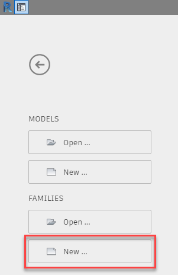

4. Revit should default you to the out of the box Family template location.
    1. You should choose a template matching the category of the element you are creating. If a match doesn't exist, choose Generic Model.
        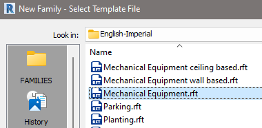
    2. Click Open
    3. You will be placed in the family editor in Revit, ready to make something.

5. Now I'd like to take a timeout to talk about Categories. It is very important you assign the proper category to families you create so the data in your model is organized.
    1. Categories organize data.
    2. Each Category of elements in Revit have their own set of restrictions.
        1. Generic / Structural category elements cannot be rotated in the model. They also will be treated as "underlay" elements so their selection will also be limited.
    3. For our purpose and the general premise of this training we are going to use **Mechanical Equipment**.
        1. Other logical choices would be:
            1. Plumbing Fixture
            2. Pipe Accessories
            3. Duct Accessories
            4. Generic
    4. Even if you had to choose Generic as a template to start your family (not all categories have template files), you can always change it once you are in the family editor.

6. Ok, back to making a family. From the Insert tab in the Ribbon, choose Import CAD.
    1. Browse to the AutoCAD drawing you wish to import and open it.
        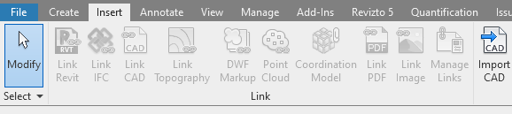
    2. The default options are generally acceptable.
        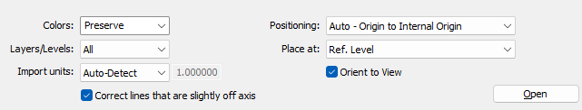
    3. You may receive an error if there is any complicated geometry in the imported model that Revit doesn't like. Sometimes this is harmless, other times half the imported model disappears and isn't useable.
        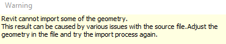
    4. You must decide if you can live with was imported or not. You can go back to the AutoCAD model and try to clean it up more or simply it so Revit will accept it.

7. Now that we have a model imported into the family editor, check it.
    1. Verify it is centered in all views.
        1. Ref. Level
        2. Back
        3. Front
        4. Left
        5. Right
    2. If you need to move the model, make sure you "Unpin" it first.
        1. All imported models will be pinned by default.

8. Save the Family

9. Load the family into your project.
    1. Insert / Load Family
        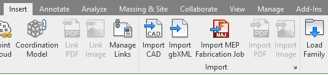
    2. Browse to file location and select open
        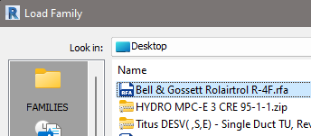

10. Locate family in project browser and drag it into your view.
    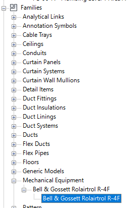

11. Family creation complete.
    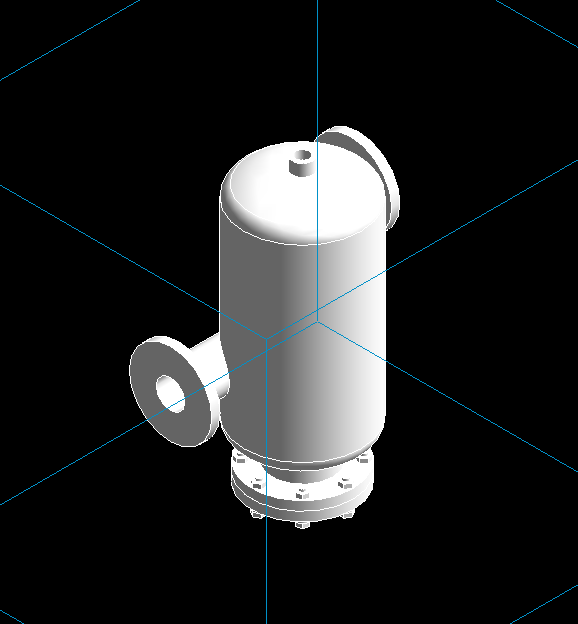

12. Now for extra credit, Lets add some connectors.

13. Double click on family in your model or open the saved family file. (either or)
    1. Open 3D view in family editor.
    2. Click on Create tab / Pipe Connector button
        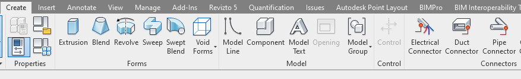
    3. Place connector.
        1. Hover cursor over edge of flange, notice how it only highlights half the circle.
            1. While hovering hit TAB once, notice how it now highlights face of flange.
                1. Left click to add a connector.
                    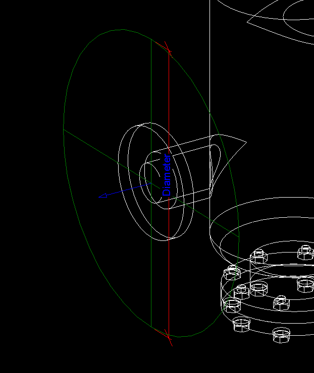
                2. It will drop a connector in. Make sure arrow is pointing away from flange.
                3. Set the proper diameter to the connector.
                    1. Select the connector and change the Diameter property to 4"
                        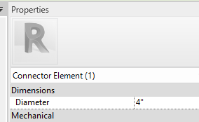
                    2. Connector in the family editor will snap to size
                    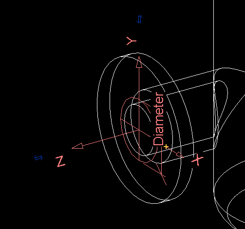
                4. Repeat as necessary for all desired connectors.

14. Save the Family

15. Load the family into your project.

16. Update the existing loaded model with your new version.

17. You will now have a family with connectors that will enforce size connection of parts.

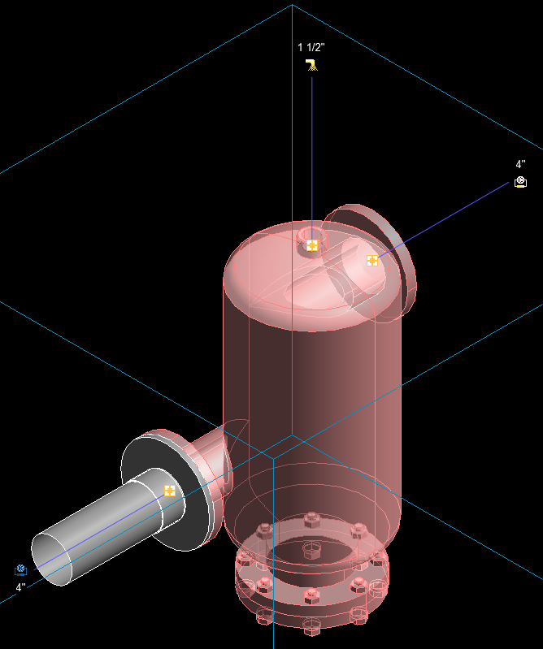
