# Revit Revisions

**Revision Data:**

- Add revision to manager (Revit has one central place where all revision data is collected)

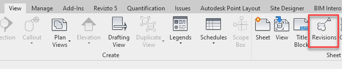

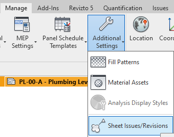

- Numbering: Choose numbering scheme (Alpahnumeric / Numeric)
    - Alphanumeric would be used for any “pre-approval” revisions A,B,C,D
    - Numeric would begin at IFC revision 0,1,2,3

- Date: Enter date of issue
    - Due to space use ##-##-## format

- Description: Enter reason for revision
    - Due to space keep this as short as possible

- Issued: Locks revision clouds and tags as read only in model
    - Issued revision clouds and tags cannot be moved
    - Issued revision data cannot be changed
    - Any revision marked as issued can also be "unmarked" and subsequently modified, lol

- Issued to: optional but you can list who sheet was issued to.

- Issued by: optional but you can list who created the revision.

- Show: Choose if tags or clouds are visible on the sheets and views

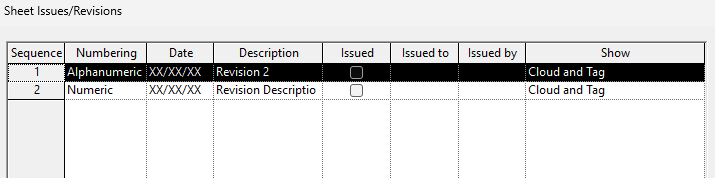

- Numbering Radial:
    - Detailing = Per Sheet
    - Engineering = Per Project

**Draw a Revision in your Project:**

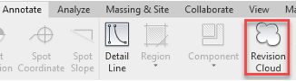

- Revision deltas are tags
    - TG
    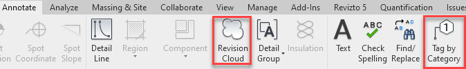

**Things to note when using revisions:**

- Title Blocks on sheets will automatically add / display any revision info of visible revision clouds in a view or sheet.
    - If these clouds are hidden or deleted in the view the revision info in the Title Block will be removed / shuffled (bad donkey)

- Revisions will be numbered on Sheets in order by their sequence number in the Revision manager
    - A revision of sequence 3 would appear before a revision of sequence 11.
    - This is visible in both the "Revisions on Sheet" dialog and the "sheet Issues/Revisions" manager.
    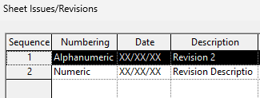

**Company standards:**

- My personal opinion for revisions is that they **ALWAYS** be placed on sheets **(not in views)**
    - One consistent place to find the clouds
    - No accidental overlap of cloud on view being picked up on adjacent sheets
    - Reduces chances of revision history in sheet getting scrambled as it's visible while messing with clouds.

- To avoid the accidental shuffling of hidden revisions always manually show revisions on sheet
    - While in a sheet (with nothing selected) click on Revisions on Sheet button in properties.
    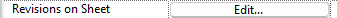
    - Check the revisions you wish to have displayed on the title block.
    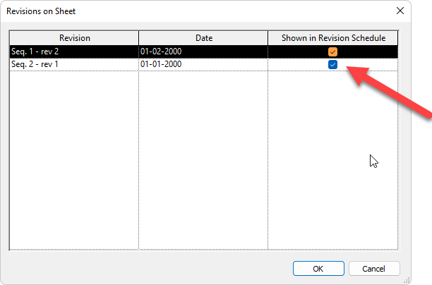

- My personal opinion is to tag all revision clouds deltas **WITHOUT** a leader

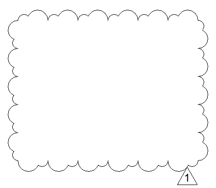

Revisions stack on sheets based on their sequence number.\
A revision of sequence 3 would appear before a revision of sequence 11.\
This is visible in both the "Revisions on Sheet" dialog and the "sheet Issues/Revisions" manager.

Lastly, there are tools that can apply revisions to sheets in bulk.

Murray Tool:

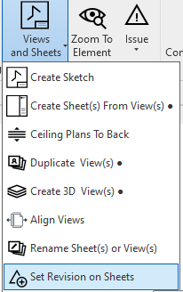

DiRoots SheetGen Tool:

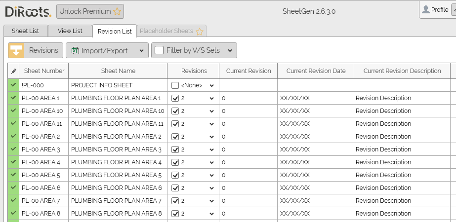

Training Video:

https://murraycompany.egnyte.com/dl/mCxHc7X7PMwC