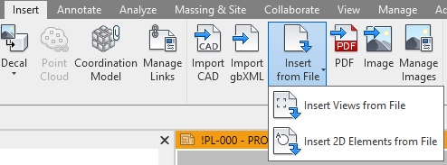
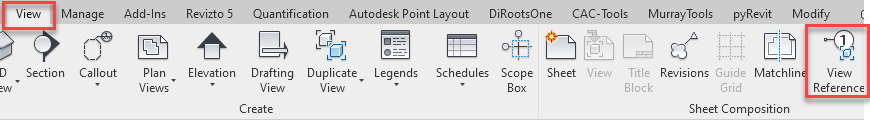
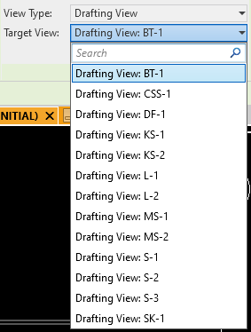
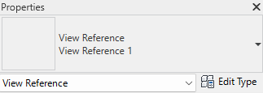
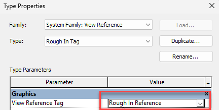
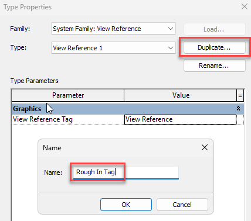

# Rough In Drawings

- There is a template file located at the following location:
    - C:\Egnyte\Shared\BIM\Murray CADetailing Dept\REVIT\TEMPLATES\ROUGH-IN TEMPLATE_2020.rvt

The workflow to make\
use of this template is as follows:

- While in your working / live Revit model.
    - Navigate to the Insert tab / Insert from File button.
        
        - If you wish to take the Sheet and the View of a Fixture choose the "Insert Views" option.
            - Importing a Sheet will also bring the corresponding view with it.
        - If you wish to take only the 2D Geometry (View) choose "Insert 2D Elements" option.
            - Note: you must be in a drafting view to use this.

Tagging a fixture on\
shop drawings

- Navigate to View tab / View Reference and place a reference

- Upon executing command look in ribbon and override the tag to look at **Drafting View**.
    - Set it to the fixture you wish to tag.

THE STEPS BELOW WILL\
BE DONE FOR YOU IN THE FUTURE. OLDER PROJECTS WILL NEED TO BE MODIFIED.

- Load Rough In tag into the model for tagging detail views / fixtures
    - C:\Egnyte\Shared\BIM\Murray CADetailing Dept\REVIT\FAMILIES\Annotation\Rough In Reference.rfa

- Use the new tag by making the following changes:
    - Navigate to View tab / View Reference and place a reference
    - Upon executing command look in ribbon and override the tag to look at **Drafting View**.
        - Set it to the fixture you wish to tag.
    - Select Edit Type at the top of the properties
    - Duplicate the View Reference Type and create a new one for Rough Ins
    - Set the new type created to use the new Rough In tag created.
    - **NEW TAG WILL ONLY WORK IF A SHEET HAS BEEN CREATED OF ROUGH IN VIEWS**

