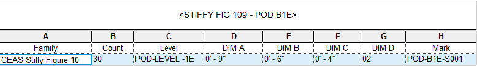
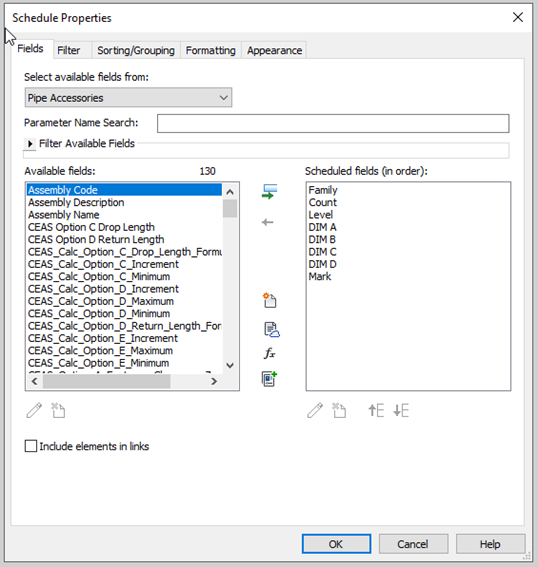
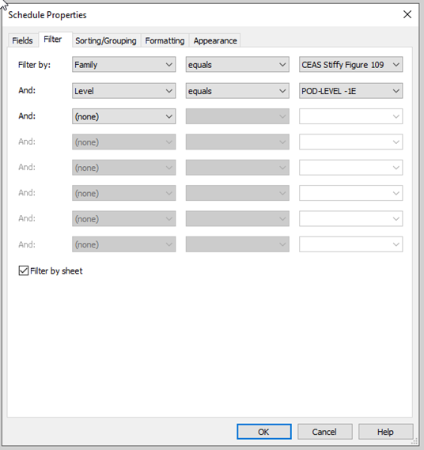
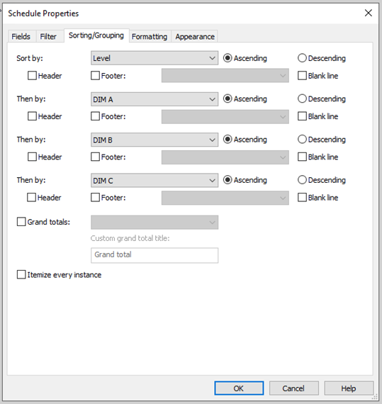
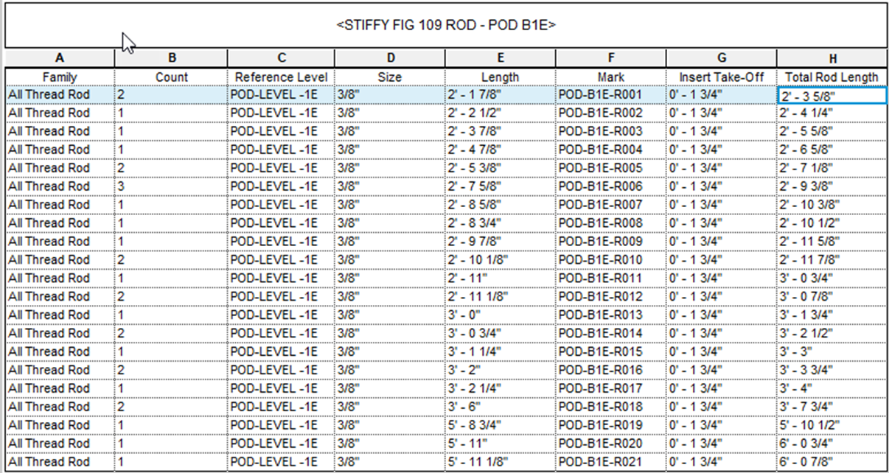
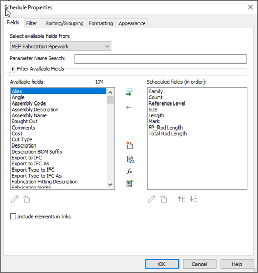
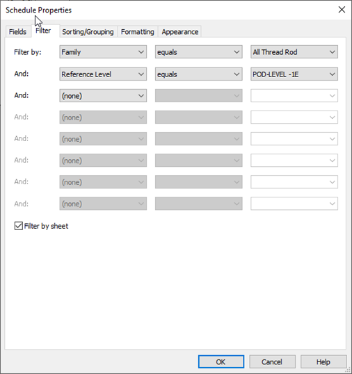
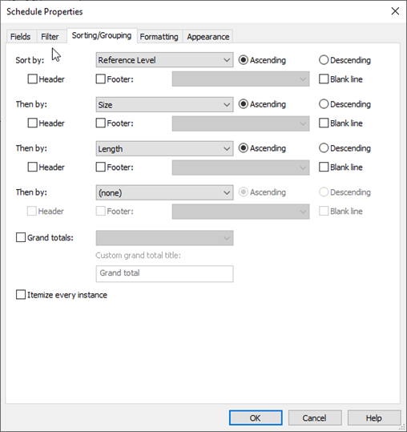
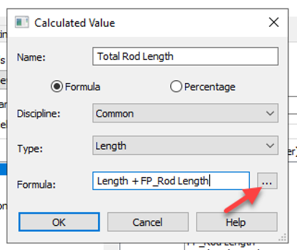
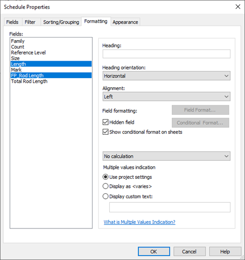

# Stiffy BOM (WIP)

Level-SR or S###\
SR=Stiffy Rack (for the 196)\
S=Stiffy (for the 109)

For Fig 109\
Create schedule and name it 'STIFFY FIG 109 BUILDING (if applicable) LEVEL'\
For example, STIFFY FIG 109 RES L1\
Schedule to include:\
Family\
Count\
Level\
DIM A\
DIM B\
DIM C\
DIM D\
Mark

Filter

Sorting and Grouping

Naming convention for Mark shall be:\
Building Reference (if applicable)-Level-S####\
S is for Stiffy then a (3) digit number starting with 001 to allow for 999 items. If more are needed then a (4) digit number can be used\
For example, OFF-L6-S001

Fig 109 will need a separate rod schedule as well\
Create schedule and name it 'STIFFY FIG 109 ROD BUILDING (if applicable) LEVEL'\
For example, STIFFY FIG 109 ROD RES L1\
Schedule to include:\
Family\
Count\
Reference Level\
Size\
Length\
Mark\
FP_Rod Length\
Total Rod Length

Filter

Sorting and Grouping

Naming convention for Mark shall be:\
Building Reference (if applicable)-Level-R####\
R is for rod then a (3) digit number starting with 001 to allow for 999 items. If more are needed then a (4) digit number can be used\
For example, OFF-L6-R001

For FP_Rod Length you will need to change the 'Heading' to 'Insert Take-Off' and enter the engagement of the rod to the insert you are using. Note that this can also be a negative number if there is rod length that needs to be removed

In order to create the 'Total Rod Length' you must got to 'Fields' and select 'fx' which is the calculated value. In this window fill out the table as seen below:

Hint: For the 'Formula' pick the (3) dots and select 'Length' then space, plus sign, then space, pick the (3) dots again and select 'FP_Rod Length'

Hide the 'Length' and the 'FP_Rod Length' in 'Formatting'

