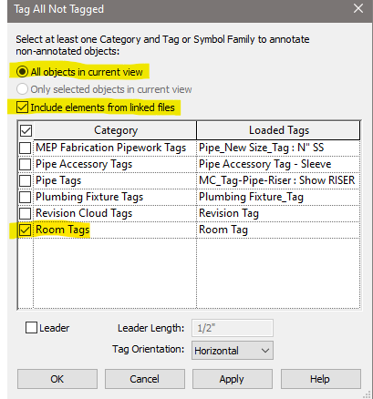

# Tagging Room Names

1. Load a room tag family

2. Make sure arch link is **NOT** set to underlay in VG settings.

3. Make sure view range cut plane is cutting through room areas
    1. 4'-0" on associated level should work (default).

4. Make sure rooms category is turned on
    1. In each link that you want to tag the rooms in
        1. Interior
        2. Core and shell
        3. In your project VG settings

5. Use tag all command on annotate tab

6. Set room tag category in view template to half tone

7. You will need to move room tags around so they do not obscure pipe or duct

