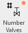
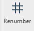
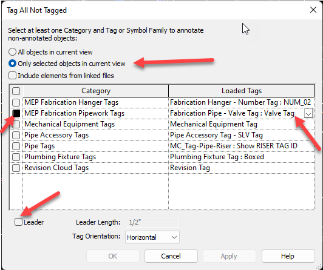

buttons: ValveRenumber, ReNumber, SelectValves, TagValves, LastValveNumber, ValveLocation, ValveSchedule, Valve Number
# Valve Numbering

**PREREQUISITE:**

1. As a user you need to be aware of what types of elements are in your model that represent valves you wish to number.
    1. Fabrication Parts
        1. Strainer (Typically not numbered)
        2. Check valve (Typically not numbered)
    2. Pipe Accessories

2. There are many ways to parse data in your model / view.
    1. Use Revit Filter
    2. DiRoots OneFilter
    3. Murray "Select Filter" button (Fabrication parts Only, mostly…)
    4. Revit Schedules

**NUMBERING:**

1. Navigate to view showing the valves you wish to renumber.
    1. An overall floorplan view seems like the right place.

2. Locate the Valve Renumber button in the Murray Ribbon.
    1. This command will try to number valves in a view that has been isolated by system.
    2. If there are valves like "Strainer" or "Check" you will need to hide them prior to running command.
    

3. Run the command.
    1. Select a valve. Valve selection determines the following:
        1. Fabrication Service
        2. Starting point for numbering sequence
    2. User must pick on a valve in the view to start the numbering sequence from.
    3. Once a valve is selected the user will be prompted to specify valve number / sequence.
        1. Standard / Generic way is **LEVEL-SYSTEM-NUMBER**
        2. I would use a (3) digit number *wink *wink
    4. Numbering will increment +1 on the next closest valve from the selected valve.
        1. This will repeat on the next furthest valve from the start until all valves in isolated view are numbered.
    5. Strainers and Check valves will be filtered out on newer jobs. Older jobs they will get numbers.
    6. If you have a mixed environment of Revit Families and Fabrication Parts representing valves you will need to use the manual method described in the next step.

4. The other (more manual) way to number valves is to use the Renumber button.
    1. With this method the user simply defines a numbering sequence and manually selects valves in the view in desired order.
        
        1. Tagging valves prior to renumbering would be best.

5. What's happening when we number the valves?
    1. User specified number is being written to (3) places (for now).
        1. Mark
        2. FP_Valve Number
        3. Fabrication Part Custom Data Field "Valve Number" (visible in AutoCAD on MAJ export)

**TAGGING:**

1. Once valves are numbered you can tag them in Revit.

2. The Revit way is to use the Tag All function.
    1. Select all valves in the view
        1. Use Murray "Select Filter" or "Select Valves"
        2. DiRoots OneFilter
    2. Navigate to annotation tab in the ribbon.
        1. Select the "Tag All"
        

3. Alternatively you can use the Murray Tag Valves button.
    1. Button should load the valve tag family and place on valves.
    2. Sometimes it doesn't activate the family properly.
        1. Place one valve tag on a valve and then run the command.

4. The tag family is configured to read the element's "Mark" number.
    1. It can be easily modified to read FP_Valve Number

5. There are (2) families that will tag a valve number.
    1. Fabrication Pipe - Valve Number
    2. Fabrication Pipe - Valve Tag
