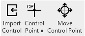
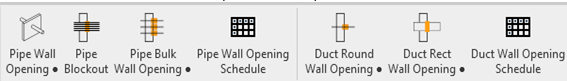
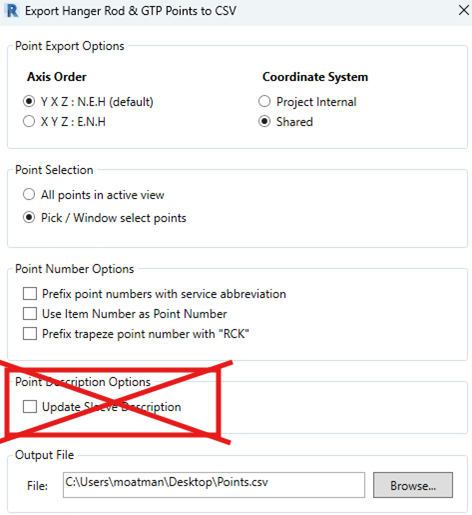
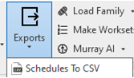
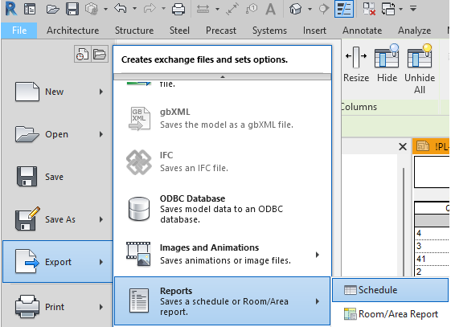
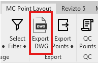

# Wall Trimble Revit

1. Make a View to be Used for Point Population
    - Views will be created by level
    - In Revit, duplicate an existing sheet view
        - In the 'Project Browser', go to 'Sheet Views', choose the sheet view of the deck level your inserting on, Right mouse click, select Duplicate View, and select 'Duplicate'

2. Place Control Points Using the 'Control Pts' Function
    - Go to the 'MC Point Layout' tab and use one of the options
        - Place manually
        - Auto Place at Grid Intersections
        - Import Control
    

3. Place wall points
    
    - Click on the appropriate button.
    - Select a pipe or duct in the model.
    - The button will place an opening on the selected element and ‘lock’ you into the Z elevation of part.
    - Pick the XY location of the opening at the intersection of service and **face of wall**.

4. There are 3 different scenarios for opening placement.
    - WS = Thru wall opening (pipe penetrating both sides of the wall at the same elevation)
    - DR-WS = Drop wall opening (pipe penetrating only one side of wall and dropping down)
    - FXTR-CL = Fixture centerline marker to be placed at 'Installed' centerline location of fixture

5. Export the points
    - The points that are to be exported need to be isolated in some way.
    - Make sure 'Update Sleeve Description' is **NOT** enabled.

6. Export the schedules to CSV (for labels)
    - Murray option is under Exports / Schedules to CSV
        
    • There is an out of the box option to export schedules as well.

7. Export DWG of the view wall layout was performed in.
    - The exported dwg file should be cleaned up prior to sending.
        - Opend DWG
        - Run C8ALL command
        - Save DWG
            

8. QC of points
    - Click the QC Points button
    - Copy that data to clipboard by clicking Copy button
    - Open the exported dwg file (step 7)
    - Paste clipboard data into the command line of AutoCAD
    - Point data contained in csv file you exported will now be marked with yellow X’s

9. Desired output(s)
    - CSV file of point coordinates (send to: field)
    - DWG of scope of work (send to: field)
    - PDF of scope of work (send to: field / cad support for printing)
    - CSV file of opening schedules (send to: Francisco for printing)

Training Video:

https://murraycompany.egnyte.com/dl/fXmm6Mv3ktPj